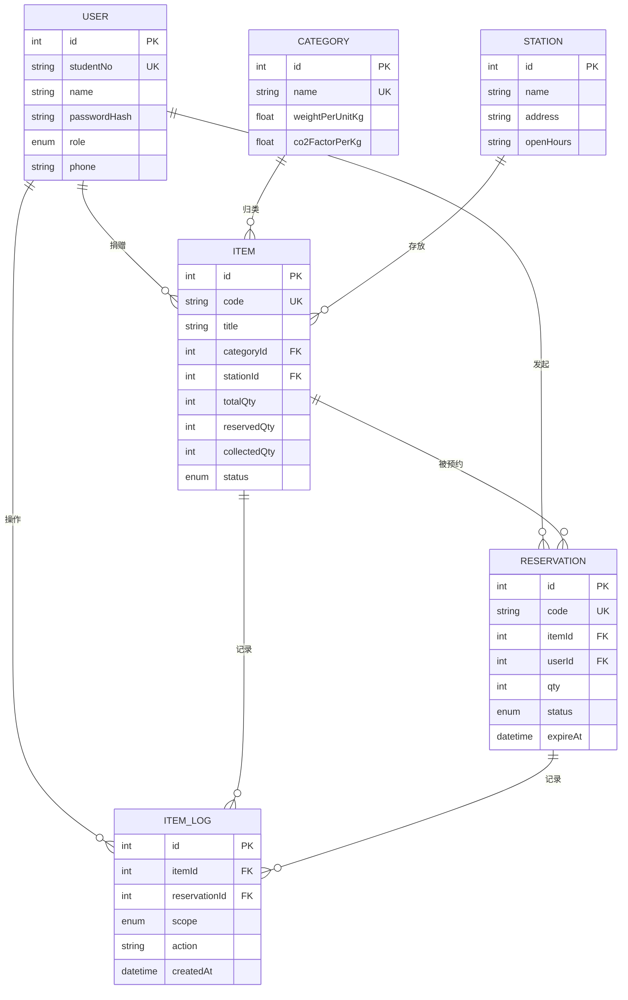

# 校园旧物捐赠平台 数据结构与系统架构说明

| 项 | 内容 |
| --- | --- |
| 文档版本 | v1.0 |
| 日期 | 2026-11-20 |
| 对应需求 | 《项目需求说明书》v1.0 |
| 读者 | 小组成员、评阅教师 |

---

## 1 架构总览

### 1.1 架构风格

前后端分离的单体应用：

- **前端**：Vue 3 SPA，构建产物为静态文件，通过 axios 调用 REST 接口
- **后端**：Node + Express 单体服务，同时承担 API 与静态资源托管
- **数据**：SQLite 单文件数据库，通过 Prisma 访问

选择单体而非微服务、选择 SQLite 而非 MySQL 的理由：本项目 3 人 3 周，并发量级为个位数，**架构复杂度必须服从交付确定性**。指南亦明确"不要把大量时间花在复杂的服务器部署上"。

### 1.2 技术栈与版本

| 层 | 选型 | 版本 | 用途 |
| --- | --- | --- | --- |
| 前端框架 | Vue | 3.4.x | 组合式 API |
| 语言 | TypeScript | 5.4.x | strict 模式 |
| 构建 | Vite | 5.x | 开发服务器与打包 |
| 路由 | Vue Router | 4.x | 路由与守卫 |
| 状态 | Pinia | 2.x | 用户态与字典 |
| 请求 | axios | 1.x | 拦截器封装 |
| 校验 | zod | 3.x | 前后端共享 schema |
| 后台 UI | Element Plus | 2.x | 表格/表单/弹窗 |
| 图表 | ECharts | 5.x | 看板 |
| 后端 | Express | 4.x | 路由与中间件 |
| ORM | Prisma | 5.x | schema、迁移、类型 |
| 数据库 | SQLite | 3.x | 单文件库 |
| 认证 | jsonwebtoken + bcryptjs | — | JWT 单 token |
| 上传 | multer | 1.x | 本地磁盘存储 |
| 日期 | dayjs | 1.x | 时间格式化与倒计时 |

### 1.3 系统架构图

```
┌─────────────────────────────────────────────────────────┐
│  浏览器（桌面，1280 设计基准）                            │
│  ┌───────────────────────────────────────────────────┐  │
│  │ Vue 3 SPA                                          │  │
│  │  views ── components ── composables ── stores      │  │
│  │    │           │            │            │         │  │
│  │    └───────────┴────────────┴────────────┘         │  │
│  │                     │                              │  │
│  │              api/（axios 实例）                     │  │
│  │                     │  请求拦截：带 token           │  │
│  │                     │  响应拦截：解包/错误码/401     │  │
│  └─────────────────────┼──────────────────────────────┘  │
└────────────────────────┼────────────────────────────────┘
                         │ HTTPS / JSON
┌────────────────────────┼────────────────────────────────┐
│  Node 服务             ▼                                │
│  ┌──────────────────────────────────────────────────┐   │
│  │ 路由层（≤20 个接口）                              │   │
│  │   auth │ items │ reservations │ admin │ stats     │   │
│  ├──────────────────────────────────────────────────┤   │
│  │ 中间件：JWT 解析 → 角色校验 → zod 入参校验         │   │
│  │         → 统一响应包装 → 全局错误处理              │   │
│  ├──────────────────────────────────────────────────┤   │
│  │ 业务逻辑（直接写在路由处理函数内，不分层）         │   │
│  │   · 条件更新占用（事务）                          │   │
│  │   · 状态机校验                                    │   │
│  │   · 日志写入                                      │   │
│  ├──────────────────────────────────────────────────┤   │
│  │ Prisma Client                                     │   │
│  └──────────────────────────────────────────────────┘   │
│         │                          │                    │
│    ┌────▼─────┐              ┌─────▼──────┐             │
│    │ SQLite   │              │ uploads/   │             │
│    │ dev.db   │              │ 图片静态目录│             │
│    └──────────┘              └────────────┘             │
└─────────────────────────────────────────────────────────┘
```

### 1.4 仓库结构

```
campus-donate/
├─ package.json              # npm workspaces，成员为 project/front 与 project/backend
├─ .env.example
├─ README.md
├─ project/
│  ├─ front/                 # 前端（Vue 3 + Vite）
│  │  ├─ src/
│  │  │  ├─ api/             # 请求实例 + 各模块接口函数
│  │  │  ├─ assets/
│  │  │  ├─ components/
│  │  │  │  ├─ base/         # AppButton / AppInput / AppTag / EmptyState
│  │  │  │  │                # SkeletonCard / ErrorState / AppModal
│  │  │  │  ├─ business/     # ItemCard / StatusBadge / TimelineStep
│  │  │  │  │                # ReservePanel / ImageUploader
│  │  │  │  └─ layout/       # SiteHeader / AdminSidebar / PageContainer
│  │  │  ├─ composables/     # useRequest / usePagination / useCountdown
│  │  │  │                   # usePermission / useToast
│  │  │  ├─ router/          # index.ts + guards.ts
│  │  │  ├─ stores/          # user.ts / dict.ts
│  │  │  ├─ styles/          # tokens.css / reset.css / base.css
│  │  │  ├─ types/           # 与后端共享的 DTO 类型
│  │  │  ├─ utils/           # format.ts / image.ts / validate.ts
│  │  │  └─ views/
│  │  │     ├─ login/  discover/  item-detail/  donate/  my-records/
│  │  │     └─ admin/  items/  redeem/  dashboard/
│  │  └─ vite.config.ts
│  └─ backend/               # 后端（Express + Prisma）
│     ├─ prisma/
│     │  ├─ schema.prisma
│     │  └─ seed.ts
│     ├─ src/
│     │  ├─ index.ts         # 入口：中间件装配 + 静态托管
│     │  ├─ lib/             # prisma.ts / jwt.ts / errors.ts / response.ts
│     │  ├─ middleware/      # auth.ts / role.ts / validate.ts / errorHandler.ts
│     │  └─ routes/          # auth.ts items.ts reservations.ts admin.ts stats.ts
│     └─ uploads/            # 运行期生成，.gitignore
└─ docs/                     # 交付文档
```

---

## 2 数据模型

### 2.1 ER 图



### 2.2 表定义

#### User 用户

| 字段 | 类型 | 约束 | 说明 |
| --- | --- | --- | --- |
| id | Int | PK, autoincrement | — |
| studentNo | String | unique | 学号，即登录账号 |
| name | String | — | 姓名 |
| passwordHash | String | — | bcrypt，cost 10 |
| role | Enum | 默认 STUDENT | STUDENT / ADMIN |
| phone | String? | — | 学生端仅展示尾号四位 |
| avatarUrl | String? | — | — |
| building | String? | — | 宿舍楼，仅用于画像统计 |
| createdAt | DateTime | 默认 now | — |
| lastLoginAt | DateTime? | — | — |

#### Category 品类

| 字段 | 类型 | 约束 | 说明 |
| --- | --- | --- | --- |
| id | Int | PK | — |
| name | String | unique | 教材书籍 / 衣物鞋帽 / 生活用品 / 小家电与数码 / 文具杂物 / 体育器材 |
| slug | String | unique | 用于路由与筛选参数 |
| icon | String | — | SVG 图标名 |
| weightPerUnitKg | Float | 默认 1.0 | 单件估重 |
| co2FactorPerKg | Float | 默认 1.0 | 单位碳因子 |
| sortOrder | Int | 默认 0 | 展示顺序 |
| active | Boolean | 默认 true | 停用后不出现在筛选 |

#### Station 驿站

| 字段 | 类型 | 约束 | 说明 |
| --- | --- | --- | --- |
| id | Int | PK | — |
| name | String | — | 如"一食堂西侧爱心驿站" |
| address | String | — | 详细位置 |
| openHours | String | — | 如"周一至周五 10:00-18:00" |
| contactPhone | String? | — | — |
| active | Boolean | 默认 true | — |

#### Item 批次（核心表）

| 字段 | 类型 | 约束 | 说明 |
| --- | --- | --- | --- |
| id | Int | PK | — |
| code | String? | unique | 入库编号 `SR-2026-0001`，收货确认时生成 |
| title | String | — | 物品标题，≤40 字 |
| description | String | — | ≥10 字 |
| categoryId | Int | FK → Category | — |
| stationId | Int | FK → Station | 送达与领取的驿站 |
| condition | Enum | — | NEW 全新 / GOOD 良好 / USABLE 可用 |
| imagesJson | String | 默认 "[]" | JSON 数组，存相对路径 |
| totalQty | Int | — | 总数量，收货时可修正 |
| reservedQty | Int | 默认 0 | 已预约未核销 |
| collectedQty | Int | 默认 0 | 已核销 |
| status | Enum | 默认 PENDING | 见 2.3 |
| donorId | Int | FK → User | 捐赠人 |
| rejectReason | String? | — | 当前驳回原因 |
| submittedAt | DateTime | 默认 now | — |
| receivedAt | DateTime? | — | 收货确认时间 |
| shelfAt | DateTime? | — | 上架时间 |
| closedAt | DateTime? | — | 完结时间 |
| updatedAt | DateTime | @updatedAt | — |

> **余量不落库**。`available = totalQty - reservedQty - collectedQty` 在查询时派生。原因见 §4.1。

#### Reservation 预约单

| 字段 | 类型 | 约束 | 说明 |
| --- | --- | --- | --- |
| id | Int | PK | — |
| code | String | unique | 8 位领取码，大写字母+数字，去掉易混字符 O/0/I/1 |
| itemId | Int | FK → Item | — |
| userId | Int | FK → User | 领取人 |
| qty | Int | — | 占用数量，1～余量 |
| status | Enum | 默认 PENDING | 见 2.3 |
| expireAt | DateTime | — | 创建时 = now + 3 天 |
| createdAt | DateTime | 默认 now | — |
| collectedAt | DateTime? | — | 核销时间 |
| collectedBy | Int? | FK → User | 核销人 |
| cancelledAt | DateTime? | — | — |
| cancelReason | String? | — | 学生取消 / 超时回收 / 下架取消 |

#### ItemLog 流转日志

| 字段 | 类型 | 约束 | 说明 |
| --- | --- | --- | --- |
| id | Int | PK | — |
| itemId | Int | FK → Item | — |
| reservationId | Int? | FK → Reservation | 预约事件才有 |
| scope | Enum | — | BATCH / RESERVATION |
| action | String | — | 语义动作名，见下表 |
| qty | Int? | — | 涉及数量 |
| fromStatus | String? | — | 变更前状态 |
| toStatus | String? | — | 变更后状态 |
| operatorId | Int | FK → User | 操作人 |
| note | String? | — | 补充说明（如收货修正差额） |
| createdAt | DateTime | 默认 now | — |

**action 取值约定**

| scope | action | 触发 |
| --- | --- | --- |
| BATCH | SUBMIT | 提交登记 |
| BATCH | APPROVE | 审核通过 |
| BATCH | REJECT | 驳回 |
| BATCH | RESUBMIT | 编辑重提 |
| BATCH | RECEIVE | 收货入库 |
| BATCH | QTY_ADJUST | 收货数量修正 |
| BATCH | OFFLINE | 下架 |
| BATCH | CLOSE | 领完完结 |
| RESERVATION | RESERVE | 被预约 |
| RESERVATION | COLLECT | 核销 |
| RESERVATION | CANCEL | 主动取消 |
| RESERVATION | EXPIRE | 超时回收 |
| RESERVATION | CANCEL_BY_OFFLINE | 下架取消 |

#### SystemConfig 配置（可选）

| 字段 | 类型 | 说明 |
| --- | --- | --- |
| key | String PK | `reservation.ttlDays` / `reservation.maxPending` |
| value | String | 存字符串，读取时转型 |
| description | String | — |

### 2.3 枚举

```prisma
enum Role        { STUDENT ADMIN }
enum Condition   { NEW GOOD USABLE }
enum ItemStatus  { PENDING REJECTED RECEIVING ON_SHELF OFFLINE CLOSED }
enum ResStatus   { PENDING COLLECTED CANCELLED EXPIRED }
enum LogScope    { BATCH RESERVATION }
```

### 2.4 索引设计

| 表 | 索引 | 支撑的查询 |
| --- | --- | --- |
| Item | `(status, categoryId)` | 发现页按品类筛选在架 |
| Item | `(status, stationId)` | 按驿站筛选 |
| Item | `(donorId, submittedAt)` | 我捐的 |
| Item | `(status, shelfAt)` | 滞销判定（在架超 30 天） |
| Reservation | `code` unique | 核销查码 |
| Reservation | `(userId, status)` | 我的领取 + 上限校验 |
| Reservation | `(itemId, status)` | 下架前校验未核销数 |
| Reservation | `(status, expireAt)` | 超时扫描 |
| ItemLog | `(itemId, createdAt)` | 时间轴渲染 |

---

## 3 接口设计（共 20 个）

统一响应格式：

```json
{ "code": 0, "message": "ok", "data": { } }
```

失败时 `code` 为业务错误码，`message` 为可直接展示的文案，HTTP 状态码统一为 200 或 4xx（见 §7）。

| # | 方法 | 路径 | 权限 | 说明 |
| --- | --- | --- | --- | --- |
| 1 | POST | `/api/auth/login` | 公开 | 学号+密码登录，返回 token 与用户信息 |
| 2 | POST | `/api/auth/logout` | 登录 | 前端清 token，服务端仅记日志 |
| 3 | GET | `/api/auth/me` | 登录 | 恢复会话 |
| 4 | GET | `/api/categories` | 公开 | 品类字典（缓存 1 小时） |
| 5 | GET | `/api/stations` | 公开 | 驿站字典 |
| 6 | GET | `/api/items` | 公开 | 发现页列表，支持 `categoryId/stationId/condition/q/keyword/page/size` |
| 7 | GET | `/api/items/:id` | 公开 | 详情 + 履历（履历中学生信息脱敏） |
| 8 | POST | `/api/items` | 学生 | 提交捐赠 |
| 9 | PATCH | `/api/items/:id` | 学生本人 | 驳回后编辑重提 |
| 10 | GET | `/api/my/donations` | 学生 | 我捐的，含状态与余量 |
| 11 | POST | `/api/items/:id/reservations` | 学生 | 创建预约（事务占用） |
| 12 | GET | `/api/my/reservations` | 学生 | 我领的，含倒计时所需 `expireAt` |
| 13 | POST | `/api/reservations/:id/cancel` | 学生本人 | 取消预约，归还数量 |
| 14 | GET | `/api/admin/items` | 管理员 | 后台列表，按 `status` 分组 |
| 15 | POST | `/api/admin/items/:id/approve` | 管理员 | 审核通过 |
| 16 | POST | `/api/admin/items/:id/reject` | 管理员 | 驳回，body 含 reason |
| 17 | POST | `/api/admin/items/:id/receive` | 管理员 | 收货确认，body 含 `actualQty` |
| 18 | POST | `/api/admin/items/:id/offline` | 管理员 | 下架（校验无未核销预约） |
| 19 | POST | `/api/admin/reservations/redeem` | 管理员 | 凭 code 核销 |
| 20 | GET | `/api/admin/stats/overview` | 管理员 | 看板 5 个指标一次返回 |

**接口数量控制说明**：字典、我的记录、看板均采用"一个接口返回一个页面所需全部数据"的聚合策略，避免按实体拆成大量细粒度接口。这是刻意的取舍——少数接口 + 前端按需组装，比 40 个 RESTful 接口更适合 3 周工期。

### 3.1 关键接口定义示例

**POST /api/items/:id/reservations**

```jsonc
// 请求
{ "qty": 2 }

// 成功
{
  "code": 0,
  "data": {
    "reservationId": 128,
    "code": "A3K9P2QX",
    "qty": 2,
    "expireAt": "2026-11-23T15:20:00+08:00",
    "item": { "id": 42, "title": "高等数学 第七版", "available": 3 }
  }
}

// 失败（余量不足）
{ "code": 3001, "message": "余量不足，当前仅剩 1 件" }
```

**POST /api/admin/reservations/redeem**

```jsonc
// 请求
{ "code": "A3K9P2QX" }

// 成功
{
  "code": 0,
  "data": {
    "itemTitle": "高等数学 第七版",
    "qty": 2,
    "collectedAt": "2026-11-20T11:40:00+08:00",
    "itemClosed": false
  }
}
```

---

## 4 关键设计决策

每条按「问题 → 方案 → 权衡」记录，这是答辩时最常被追问的部分。

### 4.1 余量为什么不存字段

- **问题**：`available` 若作为独立字段存储，需在预约、取消、核销、超时、修正数量五处同步更新，任一处遗漏即产生脏数据。
- **方案**：只存 `totalQty`、`reservedQty`、`collectedQty` 三个**事实字段**，余量在查询时派生。
- **权衡**：牺牲一次减法运算，换取"不可能不一致"。代价是无法对余量建索引直接筛选，因此"仅看有货"改为 SQL 条件 `(totalQty - reservedQty - collectedQty) > 0`，在数据量 80 条时无性能问题。

### 4.2 并发占用为什么用条件更新而非"先查再改"

- **问题**：`SELECT` 查余量 → 业务判断 → `UPDATE` 扣减，三步之间可被其他请求插入，导致超卖。
- **方案**：把判断与写入合并为一条原子语句。

```ts
const result = await prisma.$executeRaw`
  UPDATE Item
     SET reservedQty = reservedQty + ${qty}
   WHERE id = ${itemId}
     AND (totalQty - reservedQty - collectedQty) >= ${qty}
     AND status = 'ON_SHELF'
`;
if (result === 0) throw new BizError(3001, '余量不足');
```

- **权衡**：
  - 不用悲观锁（`SELECT ... FOR UPDATE`）：SQLite 无行级锁语义，且会阻塞读。
  - 不用乐观锁（version 字段）：需要额外的重试循环，代码更复杂。
  - 条件更新是**单语句原子性**，失败即"余量不足"，语义清晰，无需重试。影响行数 0 与 1 天然构成判定依据。

### 4.3 超时回收为什么用惰性判定而非定时任务

- **问题**：预约 3 天未领取需自动归还数量。
- **方案**：**惰性判定**——在三个入口处触发扫描：① 读取我的预约列表 ② 读取物品详情 ③ 核销前校验。扫描范围限于当前用户或当前批次，代价为一次 `UPDATE ... WHERE status='PENDING' AND expireAt < now`。
- **权衡**：定时任务需要常驻调度器，本地演示时若进程重启会漏跑；惰性判定"只要有人访问就一定会回收"，行为可预测、可在答辩现场演示（改数据库时间即可触发）。
- **补充**：种子数据中预置一条已超时预约，用于演示回收效果。

### 4.4 为什么后端不做分层

- **问题**：Controller / Service / Repository 三层是常见规范，但会增加文件数与跳转成本。
- **方案**：路由处理函数内直接调用 Prisma，业务逻辑以函数形式内聚在 `routes/*.ts`，共用逻辑提取到 `lib/`。
- **权衡**：本课程评分中"前端工程质量"占 10 分，后端分层不产生分数；3 周工期下，减少一层意味着少一次接口对齐会议。此决策写入文档，作为**主动取舍**而非能力缺失。

### 4.5 前端为什么不用 Pinia 存业务数据

- **问题**：把列表、详情放进 store 会导致"store 与路由参数两份真相"，刷新页面后状态错乱。
- **方案**：Pinia 只存三类：`user`（登录态与角色）、`dict`（品类/驿站，全局只读）、`ui`（全局 loading 计数）。**业务数据由页面组件持有**，通过 composable 拉取。
- **权衡**：跨页共享数据需要重新请求，但换来状态来源唯一、刷新即恢复。

### 4.6 图片为什么前端压缩后再上传

- **问题**：手机直出照片 4—8MB，80 个批次会产生数百 MB，本地磁盘与响应时间都不可接受。
- **方案**：`canvas` 压缩到长边 1280、质量 0.82，输出 WebP（不支持则 JPEG），单张控制在 300KB 内。
- **权衡**：损失部分清晰度，但列表缩略图与详情大图均足够；上传耗时从平均 6s 降到 1s 内。

---

## 5 并发与事务边界

| 操作 | 事务内动作 | 级别 |
| --- | --- | --- |
| 创建预约 | 条件更新占用 → 创建 Reservation → 写 ItemLog | 单事务 |
| 核销 | 校验预约状态 → 更新 Reservation → 更新 Item 两个数量 → 可能转 CLOSED → 写日志 | 单事务 |
| 取消预约 | 校验归属 → 更新 Reservation → `reservedQty -= qty` → 写日志 | 单事务 |
| 收货确认 | 更新 Item 状态与总量 → 生成 code → 写日志（含差额） | 单事务 |
| 下架 | 校验未核销数 → 更新状态 → 批量取消预约 → 批量写日志 | 单事务 |

**约束**：所有涉及 `reservedQty` / `collectedQty` 的写操作必须在同一个 Prisma 事务内完成，禁止跨请求修改。

---

## 6 前端架构

### 6.1 分层职责

| 层 | 目录 | 职责 | 禁止 |
| --- | --- | --- | --- |
| 页面 | `views/` | 组织布局、发起数据请求、组装组件 | 写复杂业务逻辑、直接写 axios |
| 业务组件 | `components/business/` | 单一业务语义（如 ItemCard） | 发请求 |
| 基础组件 | `components/base/` | 无业务语义，纯展示与交互 | 引入 store、调接口 |
| 组合式函数 | `composables/` | 复用逻辑（分页、倒计时、权限） | 持有跨页状态 |
| 请求层 | `api/` | 接口定义、类型标注 | 处理 UI |

### 6.2 请求封装

```ts
// api/http.ts
const http = axios.create({ baseURL: '/api', timeout: 10000 })

http.interceptors.request.use((cfg) => {
  const token = localStorage.getItem('token')
  if (token) cfg.headers.Authorization = `Bearer ${token}`
  uiStore.beginLoading()
  return cfg
})

http.interceptors.response.use(
  (res) => {
    uiStore.endLoading()
    const { code, data, message } = res.data
    if (code !== 0) return Promise.reject(new BizError(code, message))
    return data
  },
  (err) => {
    uiStore.endLoading()
    if (err.response?.status === 401) { userStore.logout(); router.push('/login') }
    return Promise.reject(toFriendlyError(err))
  }
)
```

**错误统一处理**：业务错误码由 `BizError` 携文案向上抛，页面只决定"就地提示"还是"整页错误态"；网络错误由 `toFriendlyError` 转成中文文案。

### 6.3 四态的统一样式

`useRequest` 返回 `{ data, loading, error, refresh }`，页面用 `<AsyncState>` 包裹：

```vue
<AsyncState :loading="loading" :error="error" :empty="!list.length" @retry="refresh">
  <ItemGrid :list="list" />
</AsyncState>
```

四个状态由组件统一渲染（骨架屏 / 错误态带重试 / 空状态带引导 / 正常内容），**保证全站一致，且每个新页面零成本接入**。

### 6.4 设计 token（用户端手写 CSS 的基础）

| 类别 | 取值 |
| --- | --- |
| 主色 | `--c-primary: #2F7D4F`（公益绿） |
| 强调色 | `--c-accent: #E8833A`（暖橙，用于"预约/领取"） |
| 语义色 | `--c-success #2F7D4F` / `--c-warning #C98A1B` / `--c-danger #C0392B` / `--c-info #2A6EA8` |
| 中性色阶 | `--c-ink-900 #1A1A1A` → `--c-ink-100 #F5F5F3`，共 9 级 |
| 字阶 | 12 / 14 / 16 / 20 / 24 / 32，行高 1.5—1.75 |
| 间距 | 4 的倍数：4 / 8 / 12 / 16 / 24 / 32 / 48 / 64 |
| 圆角 | 4 / 8 / 12 / 999 |
| 阴影 | 3 级，仅用于浮层与卡片 hover |
| 动效 | 150ms（微交互）/ 250ms（过渡）/ 400ms（入场），缓动 `cubic-bezier(.2,.8,.2,1)` |

**动效清单**（对应评分"用户体验"与课程的"版式与 CSS 动画"）

| 位置 | 实现 |
| --- | --- |
| 履历时间轴节点 | `IntersectionObserver` 触发逐节点淡入上移，`prefers-reduced-motion` 时降级为直接显示 |
| 卡片 hover | `transform: translateY(-2px)` + 阴影过渡，250ms |
| 图片加载 | 先渲染 `blur-up` 占位（20px 缩略图放大模糊），大图 `onload` 后淡入 |
| 列表切换 | `TransitionGroup` 做淡入，避免骨架屏到内容的跳变 |
| 预约成功 | 领取码卡片 400ms 缩放弹出 |

### 6.5 性能处理

| 对象 | 手段 |
| --- | --- |
| 列表 | 分页（每页 12）+ 加载更多；卡片组件 `v-memo` 避免重复渲染 |
| 图片 | 懒加载（`loading="lazy"` + IntersectionObserver 兜底）、blur-up、固定宽高比防抖动 |
| 路由 | 全部路由懒加载，后台路由单独分包 |
| 重复组件 | 基础组件全局注册，业务组件按需引入 |
| 首屏 | 字典数据缓存 1 小时；运营位插画用 SVG 而非位图 |

---

## 7 错误码与异常处理

| 码 | 含义 | HTTP | 前端表现 |
| --- | --- | --- | --- |
| 0 | 成功 | 200 | — |
| 1001 | 参数校验失败 | 400 | 表单字段级提示 |
| 1002 | 未登录或 token 失效 | 401 | 跳登录，回跳原页 |
| 1003 | 无权限 | 403 | 403 页或按钮禁用 |
| 2001 | 资源不存在 | 404 | 404 页或空状态 |
| 3001 | 余量不足 | 409 | 就地提示 + 刷新余量 |
| 3002 | 当前状态不允许该操作 | 409 | 就地提示 + 刷新数据 |
| 3003 | 预约已超时 | 409 | 提示数量已归还 |
| 3004 | 重复核销 | 409 | 展示首次核销时间与操作人 |
| 3005 | 超出未领取上限 | 409 | 提示上限并给出跳转"我的记录" |
| 3006 | 存在未核销预约，禁止下架 | 409 | 提示需先取消 N 个预约 |
| 4001 | 文件类型或大小不合法 | 400 | 上传组件内提示 |
| 5000 | 服务端异常 | 500 | 错误态 + 重试 |

**兜底**：后端 `errorHandler` 捕获所有未处理异常并统一返回 5000，避免栈信息外泄；前端 `app.config.errorHandler` 与 `onErrorCaptured` 捕获渲染错误，展示错误边界页而非白屏。

---

## 8 运行与部署

### 8.1 环境要求

| 项 | 要求 |
| --- | --- |
| Node | ≥20.10（`.nvmrc` 与 `engines` 双重锁定） |
| npm | ≥10 |
| 操作系统 | Windows / macOS / Linux 均可 |

### 8.2 启动步骤（README 内容）

```bash
# 1. 安装
npm install

# 2. 配置
cp .env.example .env          # 填写 JWT_SECRET

# 3. 建库与种子（幂等，可重复执行）
npm run db:push
npm run db:seed

# 4. 开发（前后端并行）
npm run dev                   # 前端 5173 · 后端 3001

# 5. 生产构建
npm run build && npm start    # 单端口 3001 托管静态资源
```

### 8.3 演示方案

| 方案 | 说明 |
| --- | --- |
| 主方案 | 本机 `npm run build && npm start`，浏览器访问 `http://localhost:3001` |
| 备用 | 局域网内另一台设备访问本机 IP |
| 兜底 | 预置 `dev.db` 与 `uploads/` 的压缩包，解压即可运行，不依赖种子脚本 |

**不采用公网部署的理由**：SQLite 在多数免费 PaaS 上无持久卷，重启即丢数据，答辩现场风险高于收益。此判断与指南"不要把大量时间花在复杂服务器部署"一致。

### 8.4 演示账号

| 角色 | 账号 | 密码 |
| --- | --- | --- |
| 管理员 | `admin01` | `admin123` |
| 学生（有捐赠与预约） | `2022010101` | `123456` |
| 学生（无记录，用于演示空状态） | `2023010202` | `123456` |

---

## 9 测试要点（冒烟用例）

| 编号 | 模块 | 用例 | 期望 |
| --- | --- | --- | --- |
| T-01 | 认证 | 错误密码登录 | 提示"学号或密码错误"，不泄露账号是否存在 |
| T-02 | 权限 | 学生直接访问 `/admin/items` | 跳转 403 |
| T-03 | 权限 | 学生调用核销接口 | 返回 1003 |
| T-04 | 状态机 | 待审核批次直接核销 | 返回 3002 |
| T-05 | 并发 | 余量 1 时两请求同时预约 | 一成功一 3001 |
| T-06 | 上限 | 已有 2 单再预约 | 返回 3005 |
| T-07 | 超时 | 核销 expireAt 已过的预约 | 返回 3003，余量已归还 |
| T-08 | 重复 | 同一码核销两次 | 第二次 3004 |
| T-09 | 下架 | 有未核销预约时下架 | 返回 3006 |
| T-10 | 完结 | 最后一件核销 | 批次转 CLOSED，公开列表不可见 |
| T-11 | 修正 | 收货数量修正 | 总量更新，履历出现差额记录 |
| T-12 | 脱敏 | 学生查看他人履历 | 不出现学号与全名 |
| T-13 | 四态 | 断网后加载列表 | 错误态 + 重试可用 |
| T-14 | 空态 | 新账号打开我的记录 | 空状态 + 引导按钮 |
| T-15 | 响应式 | 窗口从 1280 拖到 760 | 布局重排无横向滚动、无重叠 |

---

## 10 与指南技术要求的对应

| 指南要求 | 本项目实现 |
| --- | --- |
| 主流前端框架 | Vue 3.4 + TypeScript |
| 组件化与统一代码规范 | base/business/layout 三层 + ESLint/Prettier/commitlint |
| 路由、状态管理、表单校验、请求封装 | Vue Router 守卫 / Pinia 三 store / zod 共享 schema / axios 双拦截器 |
| 列表、图片、重复组件的性能处理 | 分页 + 懒加载 + blur-up + 前端压缩 + `v-memo` + 路由分包 |
| 加载中/失败/无数据/无权限 | `AsyncState` 统一四态，逐页接入 |
| 可重复运行的启动说明与演示包 | README 五步 + `.env.example` + 幂等种子 + `engines` 锁定 + 预置数据库包 |
| 可用模拟后端或轻量数据库 | SQLite 轻量库，无外部接口依赖 |
